# edge-lab

**인터넷 없이 내 컴퓨터에서 하는 AI 실습**

**한국어** · [English](#edge-lab-english)

> **[⬇ 다운로드 (최신 배포판)](https://github.com/themakerrobot/edge-lab/releases/latest)** — 압축을 풀고 `edge-lab.exe`(또는 `run.bat`)를 두 번 누르면 끝. 코딩 실습(JupyterLab)은 `lab.bat`. 파이썬 · 모델이 다 들어 있어 설치도 인터넷도 필요 없습니다 (5GB 남짓).
> 지난 버전은 [허깅페이스 release/](https://huggingface.co/leeyunjai/edge-lab/tree/main/release) 에 있습니다.

사진을 찍어 AI에게 물어보고, 블록과 파이썬으로 AI를 부르는 프로그램을 만들고,
내가 직접 AI를 가르쳐 봅니다. 설치가 끝나면 **인터넷을 끊어도 전부 그대로 동작**하고,
찍은 사진과 만든 것은 이 PC 밖으로 나가지 않습니다.

Intel AI PC의 CPU·GPU·NPU에 일을 나눠 실행합니다. 클라우드도, 계정도, 요금도 없습니다.

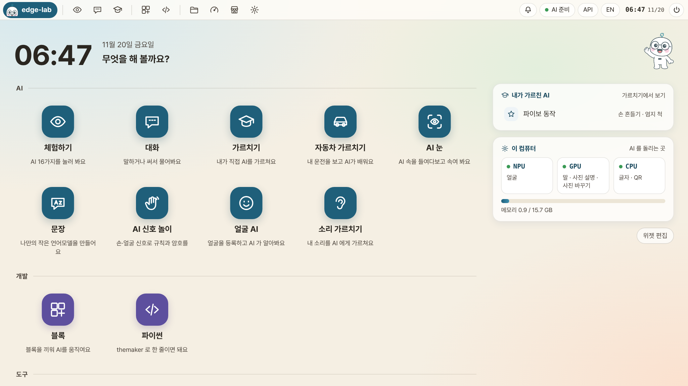

---

## 무엇을 할 수 있나

홈은 AI · 개발 · 도구 묶음으로 아이콘이 놓여 있습니다. 누르면 열리고, 오른쪽 위 **× 닫기**로 돌아옵니다.
아래는 중심이 되는 여섯 가지입니다. 그 밖에 자동차 가르치기 · AI 눈 · 문장 · AI 신호 놀이 · 소리 가르치기와
그림판 · 타자 연습 · 피아노 같은 도구가 있고, **앱 가게**에서 수업에 쓸 것만 넣고 뺍니다.

### 체험하기 — AI 16가지를 눌러 봐요

웹캠으로 찍거나, 사진을 올리거나, 스케치북에 그려서 AI에게 넣습니다.
**라이브**를 켜면 웹캠을 보면서 계속 알아봅니다.

| 묶음 | 할 수 있는 것 |
|---|---|
| 얼굴 | 얼굴 찾기 · 나이/성별 · 감정 · 거리와 방향 · 마스크를 썼는지 |
| 몸 · 손 | 사람 자세(관절 17점) · 손동작(손가락 21점) |
| 사물 | 80가지 사물 찾기 · 사물 영역 색칠 |
| 말로 답하는 AI | 사진을 보고 묻는 말에 답하기 |
| 사진 바꾸기 | 배경 지우기 · 화질 4배 개선 · 깊이 지도(멀고 가까움을 색으로) |
| 글자 · QR | 글자 읽기(한/영) · QR 읽기 |

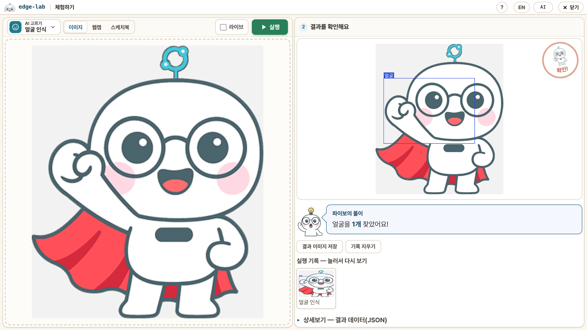

### 블록 — 블록을 끼워 AI를 움직여요

이미지 · AI 인식 · 소리 · AI 언어 · 이벤트 블록을 논리 · 반복 · 변수 같은 기본 블록과 끼워 맞춥니다.
**예제**를 불러와 바로 돌려 볼 수 있고, 만든 작품은 저장했다가 다시 엽니다.
**내가 만든 블록이 파이썬으로 어떻게 되는지** 옆에서 보고, 그대로 파이썬 화면으로 넘길 수 있습니다.

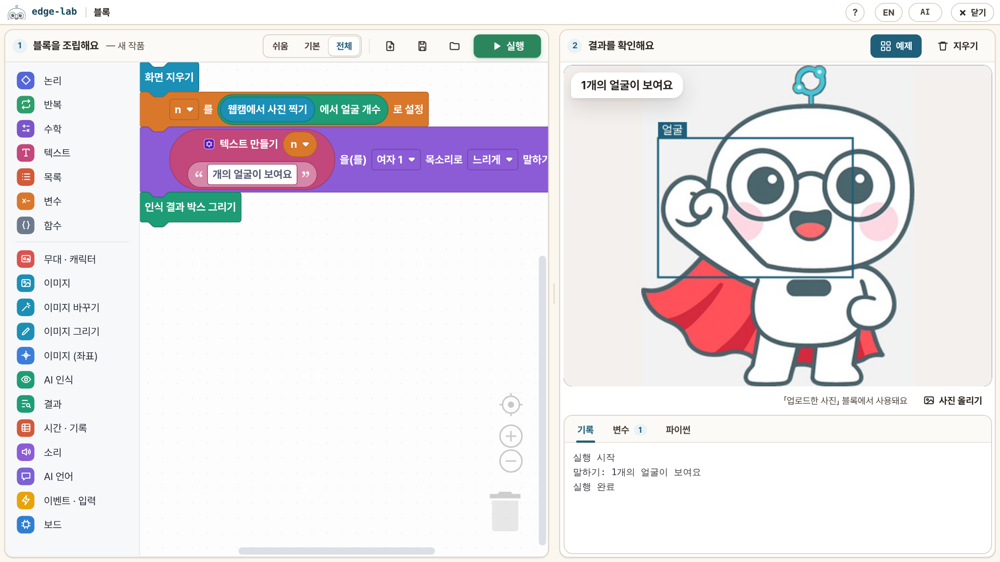

### 파이썬 — 한 줄이면 돼요

`themaker` 라이브러리로 AI를 부릅니다. 예제 16종과 도움말, 자동완성이 함께 있습니다.
오류가 나면 Traceback 대신 **오류 코드 · 몇 번째 줄 · 해 볼 것**을 보여 줍니다(블록도 같아요 — [사용 설명서](docs/MANUAL.md)의 오류 코드 표).

```python
from themaker import *

photo = camera()                      # 웹캠으로 한 장
print(vision("object", photo))        # 무엇이 보이나
show(vision("depth", photo))          # 멀고 가까움을 색으로
speak("안녕하세요")                     # 말하기
```

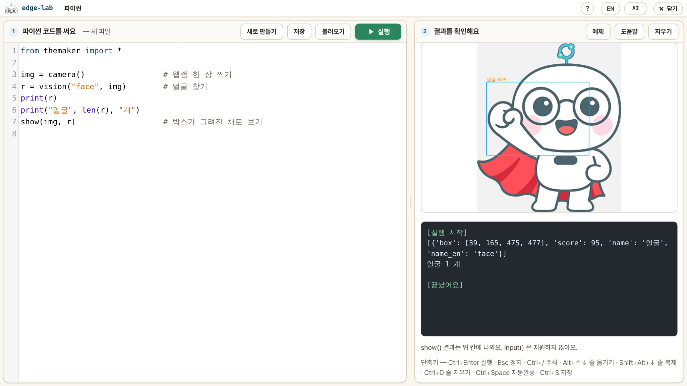

### 가르치기 — 내가 직접 AI를 가르쳐요

구별할 종류를 만들고(예: 가위·바위·보), 웹캠으로 예시 사진을 모아 학습시키면 바로 시험해 볼 수 있습니다.
사진 대신 **손 모양 · 두 손 · 표정 · 상반신 · 전신**으로도 배웁니다.

얼마나 잘 배웠는지 정확도와 학습 곡선으로 보여 주고, 틀린 사진도 함께 보여 줍니다.
만든 AI를 저장하면 **체험하기 · 블록 · 파이썬에서 그대로 불러 씁니다.**
학습은 이 컴퓨터 안에서만 하고, 찍은 사진은 밖으로 나가지 않습니다.

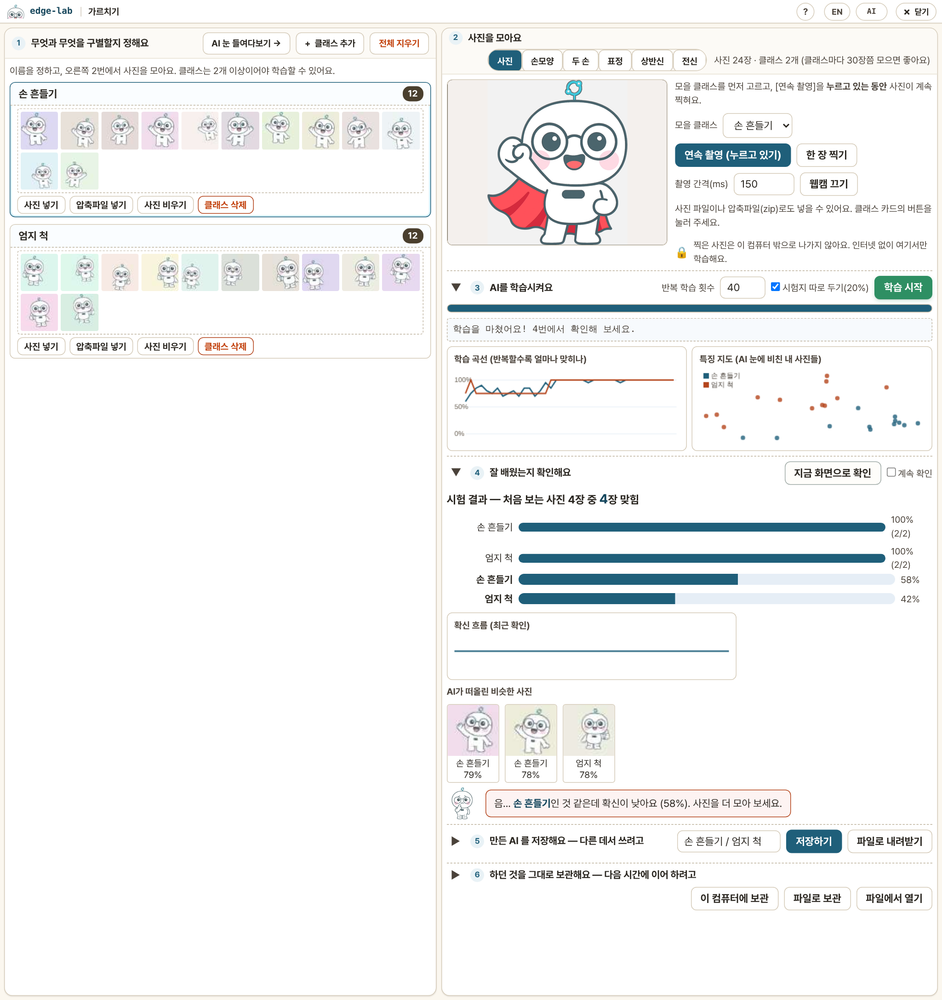

### 대화 — 말하거나 써서 물어봐요

마이크로 말하거나 글로 씁니다. **읽어주기**를 켜면 목소리로 답하고, 목소리와 말투를 고를 수 있습니다.

**내 자료를 넣어 두면 그 안에서 찾아 답합니다.** 수업 자료를 붙여 넣고 물어보면
어디서 가져왔는지도 함께 보여 줍니다.

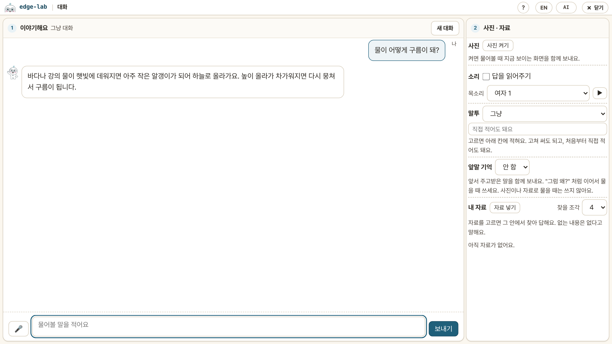

### 얼굴 AI — 얼굴을 등록하고 AI 가 알아봐요

이름을 적고 **[지금 화면으로 등록]** 하면, 그다음부터 카메라에 그 사람이 보일 때 화면에 이름이 뜹니다.
처음 보는 사람은 '모르는 사람'. 아래 정보 칸에는 얼굴마다 나이 · 성별(AI 짐작) · 감정 · 방향 · 거리 · 마스크가 나옵니다.
**말하기**를 켜면 알아본 사람에게 적어 둔 말(`[이름] 안녕하세요!`)을 읽어 줍니다.

- 파이보 · 파이브레인과 **같은 모델 · 같은 명단 파일**입니다. **[명단 저장하기]** 한 `facedb.json` 은 로봇의 `Face.load_db()` 로도 열리고, 로봇이 `Face.save_db()` 한 파일도 **[명단 불러오기]** 로 열립니다.
- **사진은 저장하지 않습니다.** 얼굴에서 뽑은 숫자(256개)만 이 컴퓨터의 `face/facedb.json` 에 두고, 이름별 · 전체 지우기가 있습니다. 다른 사람 얼굴은 허락을 받고 등록합니다.
- 블록(누구인지 · 얼굴 등록)과 파이썬(`face_register` · `face_who` · `vision("who", img)` …)에서도 같은 명단을 씁니다.

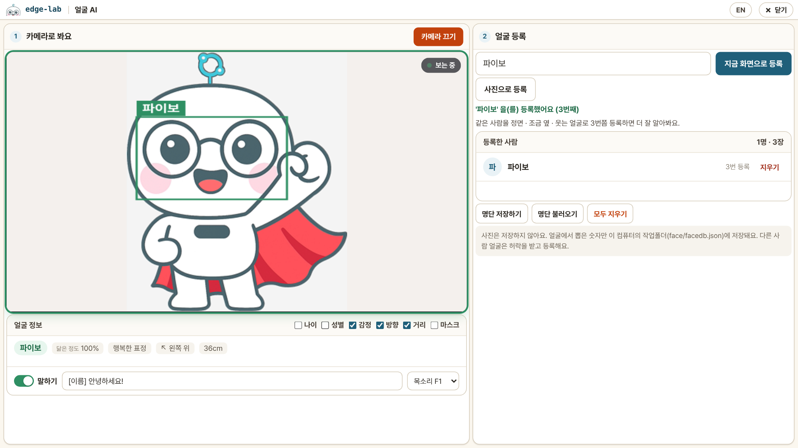

### 설정 — 수업 전 점검

**카메라 · 소리 · 마이크**가 되는지 한 번에 확인합니다. 마이크 시험은 3초 녹음해 그대로 되들려 주므로
마이크와 스피커가 함께 확인됩니다. 밝은 교실에서 화면이 잘 안 보이면 **밝은 곳 모드**를 켭니다.

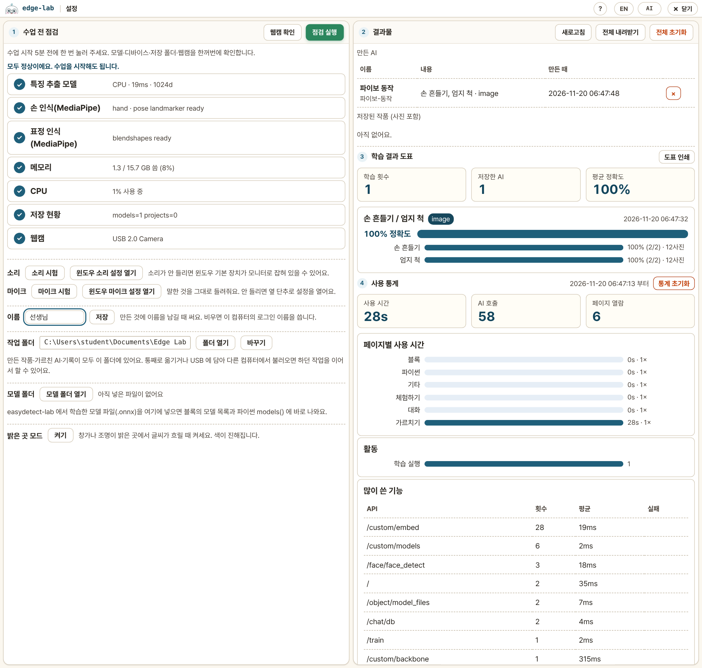

---

## 처음 켜면

AI를 메모리에 올리는 동안 진행 막대가 보이고, 그 사이 파이보가 이 도구가 하는 일을 짧게 안내합니다.
처음 켤 때는 1~2분, 그 다음부터는 금방입니다.

각 화면을 처음 열면 파이보가 말풍선으로 한 바퀴 안내합니다. 오른쪽 위 **?** 를 누르면 언제든 다시 봅니다.
**EN** 으로 영어 화면으로 바꿉니다.

**웹캠은 없어도 됩니다.** 카메라가 없거나 다른 프로그램이 쓰고 있어도 화면은 그대로 돌아갑니다 —
사진을 올려서 하면 됩니다. 카메라는 사진을 찍는 순간에만 켜집니다.

---

## 내가 만든 것은 어디에

작품과 기록은 프로그램 폴더가 아니라 **`문서\Edge Lab`** 에 따로 저장됩니다.
새 버전으로 덮어써도 사라지지 않습니다.

| 폴더 | 들어 있는 것 |
|---|---|
| `user` | 가르친 AI |
| `project` | 가르치기에서 보관한 작품 (사진 포함) |
| `blocks` | 블록 작품 |
| `pycode` | 파이썬 작품 |
| `db` | 대화에 넣은 자료 |
| `stats` | 사용 기록 · 학습 결과 |
| `models` | easydetect-lab 에서 가져온 모델 (설정 → 모델 폴더) |
| `notebooks` | 코딩 실습 노트북 (lab.bat) |
| `face` | 얼굴 AI 에서 등록한 얼굴 명단 `facedb.json` (사진 없이 숫자만) |

설정의 **[폴더 열기]** 로 탐색기에서 바로 열립니다.

**USB로 들고 다니기** — 이 폴더를 통째로 복사해 두고, 다른 PC에서 설정의 **[바꾸기]** 로
그 폴더를 고르면 이름·작품·기록까지 그대로 이어서 씁니다.

---

## 설치 · 실행

**배포판** — [최신 릴리즈](https://github.com/themakerrobot/edge-lab/releases/latest) 의 다운로드 링크로 zip 을 받아 압축을 풀고 `edge-lab.exe`(또는 `run.bat`)를 두 번 누릅니다. 코딩 실습은 `lab.bat`, 점검은 `bundle_check.bat`. 설치가 필요 없고 인터넷 없는 교실 PC 에 USB 로 옮겨도 됩니다.

**저장소에서 설치** (개발 · 수업 준비 PC)

화면 하나하나 어디가 무엇을 하는 곳인지는 **[사용 설명서](docs/MANUAL.md)** 에 그림으로 있습니다.

**설치는 `setup.bat` 더블클릭**으로 끝납니다 (venv · 패키지 · 모델 · 글꼴 · 점검까지). 자세한 것은 [INSTALL.md](INSTALL.md). 설치가 끝나면:

```
.\run.bat
```

탐색기에서 `run.bat` 을 더블클릭해도 됩니다. 브라우저가 자동으로 열립니다.

**코딩 실습** — `lab.bat` (우분투 `./lab.sh`) 을 실행하면 JupyterLab 이 열립니다. `notebooks\` 의 노트북 12개로
래퍼 없이 OpenVINO · numpy · OpenCV 를 직접 씁니다 (사물 찾기 직접 추론, 얼굴 분석, 나만의 분류기, RAG, VLM, 음성, 보드 시리얼 …).
노트북마다 개념 설명 → 실습 → 자주 나는 오류 → 정리 → **미니 프로젝트**(얼굴 모자이크 카메라, 사람 수 세기, 명함 스캐너, 가위바위보, 문서 Q&A 봇, 음성 비서 …) 순서입니다.
노트북은 `문서\Edge Lab\notebooks` 에 복사해 쓰므로 새 버전을 깔아도 고친 것이 남습니다. 영어 수업용 노트북은 같은 폴더의 `en\` 에 있습니다.

코드를 고칠 때 규칙은 [DEVELOP.md](DEVELOP.md) 에 있습니다.

---

## 안에서 도는 AI

| 하는 일 | 모델 | 도는 곳 |
|---|---|---|
| 사진 질문 · 대화 | Gemma 3 4B INT4 | GPU |
| 사물 찾기 · 자세 · 분할 | easydetect ed-m · pose-m · MobileSAM (.onnx) | CPU |
| 마스크 | MediaPipe mobilenet_v3_small 임베더 + 분류기 (`mask.onnx` 한 개) | CPU |
| 얼굴 검출 · 나이/성별 · 감정 · 방향 | OpenVINO 프리트레인 | NPU |
| 얼굴 구분(얼굴 AI · 얼굴 등록) | OpenVINO face-reidentification-retail-0095 (파이보 · 파이브레인과 같은 파일) | CPU |
| 얼굴 거리 · 손동작 · 표정 학습 | MediaPipe | CPU |
| 깊이 지도 | Depth Anything V2 Small | GPU |
| 배경 제거 · 화질 개선 | U2Net · SR-1032 | GPU |
| 글자 인식 | easyocr (한/영) | CPU |
| QR 인식 | OpenCV QRCodeDetector | CPU |
| 가르치기 특징 | mobilenet_v3_small 1024d (OpenVINO f32) · MediaPipe 손 · 표정 · 자세 — 로봇과 같은 파일(`models/mediapipe/`) | CPU |
| 말을 글자로 | SenseVoiceSmall INT8 (파이보 · 파이브레인과 같은 파일) | CPU |
| 글자를 말로 | Supertonic 3 | CPU |

---

## 라이선스

이 프로젝트의 **코드는 Apache-2.0** 으로 배포합니다 (`LICENSE`, `NOTICE`).
함께 받는 **모델 · 라이브러리는 각자의 라이선스**를 따릅니다 — 아래 표. 대부분 Apache-2.0 · MIT 이지만
**Gemma 3(VLM)와 Supertonic 3(읽어 주기)는 사용 제한이 있는 별도 라이선스**입니다.
(2026-10 까지의 버전은 YOLO(ultralytics)를 포함해 AGPL-3.0 이었습니다. 이제 ultralytics 와 그 가중치는 쓰지 않습니다.)

| 구성 요소 | 라이선스 |
|---|---|
| edge-lab 코드 · 노트북 | Apache-2.0 |
| easydetect (코드 · ed-m · pose-m 가중치) · MobileSAM — 사물 찾기 · 자세 · 영역 | Apache-2.0 |
| 마스크 분류 `mask/mask.onnx` (MediaPipe mobilenet_v3_small 임베더 + 분류기) | Apache-2.0 |
| OpenVINO / open_model_zoo 얼굴 모델 · 화질 개선(SR-1032) | Apache-2.0 |
| MediaPipe (손 · 얼굴 · 자세 점, mobilenet_v3_small 임베더, YAMNet) · U2Net · easyocr · Depth Anything V2 Small · MobileNetV2(노트북 07 · 예전 가르치기 모델) | Apache-2.0 |
| multilingual-e5-small (자료 찾기) · silero VAD (말 구간 찾기) | MIT |
| SenseVoiceSmall (받아쓰기 모델 가중치, sherpa-onnx int8 변환본) | **FunASR Model License 1.1** (출처 · 저작자 표시와 모델 이름 유지 — 원문 `models/stt-sv/LICENSE-SenseVoice.txt`) |
| sherpa-onnx (받아쓰기 실행) | Apache-2.0 |
| Gemma 3 (VLM) | **Gemma Terms of Use** (사용 제한 정책 포함) |
| Supertonic 3 (읽어 주기 모델 가중치) | **OpenRAIL-M** (사용 제한 — 아래) |
| Supertonic 추론 절차 (speech_routes.py) · ml-lab · teach-lab 에서 옮긴 코드 | MIT |
| Blockly / TensorFlow.js / Swagger UI / CodeMirror / JSZip | Apache-2.0 / Apache-2.0 / Apache-2.0 / MIT / MIT |
| 글꼴 Pretendard · Gowun Dodum · Gowun Batang | SIL OFL 1.1 |

**TTS 모델(OpenRAIL-M)을 남에게 넘길 때** — 상업 사용·재배포·서비스 호스팅은 허용됩니다. 다만
① 라이선스 사본(`models/tts-int8/LICENSE-OpenRAIL-M.txt`)을 함께 주고, ② 이용 약관에 **Attachment A의 사용 제한**을 그대로 넣어
받는 쪽에 알리고, ③ 모델 파일을 고쳤다면 고쳤다는 표시를 남깁니다.
주요 제한(발췌): 미성년자 착취·가해, 허위정보 유포, 동의 없는 인물 사칭, 기계 생성물임을 밝히지 않은 배포,
의료 조언·판독, 법집행·출입국 자동판정 등. 이 제한은 **TTS 모델 가중치에만** 적용됩니다.

---
---

<a name="edge-lab-english"></a>

# edge-lab (English)

**Hands-on AI that runs on your own computer, no internet**

[한국어](#edge-lab) · **English**

> **[⬇ Download (latest release)](https://github.com/themakerrobot/edge-lab/releases/latest)** — unzip and double-click `edge-lab.exe` (or `run.bat`). For the coding lab (JupyterLab), `lab.bat`. Python and the models are inside, so there is nothing to install and no internet needed (about 5 GB).
> Older versions are in [Hugging Face release/](https://huggingface.co/leeyunjai/edge-lab/tree/main/release).

Take a photo and ask the AI about it, build programs that call AI with blocks and Python,
and train an AI of your own. Once installed, **everything keeps working with the internet unplugged**,
and the photos you take and the things you make never leave this PC.

Work is split across the CPU, GPU and NPU of an Intel AI PC. No cloud, no account, no bills.

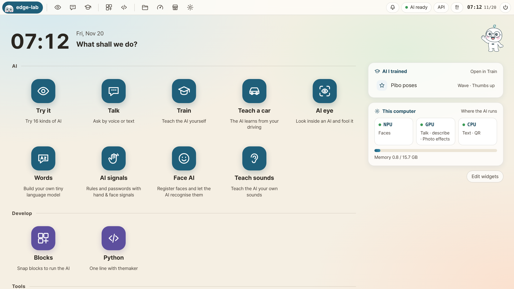

---

## What you can do

The Home screen groups icons into AI, Develop and Tools. Press one to open it, and **× Close** at the top right to come back.
Below are the six core ones. There are also Teach a car, AI eye, Words, AI signals and Teach sounds,
plus tools such as Paint, Typing and Piano — add or remove them in the **App store** to fit your class.

### Try it — 16 kinds of AI, one press away

Take a webcam shot, upload a photo, or draw on the sketchpad and feed it to the AI.
Turn on **Live** to keep recognizing straight from the webcam.

| Group | What it does |
|---|---|
| Face | Find faces · age/gender · emotion · distance and direction · wearing a mask |
| Body & hands | Human pose (17 joints) · hand gestures (21 finger points) |
| Objects | Find 80 kinds of objects · color in each object's area |
| AI that answers in words | Look at a photo and answer your question |
| Change the photo | Remove background · 4× upscale · depth map (near and far as color) |
| Text & QR | Read text (KO/EN) · read QR codes |


### Blocks — snap blocks together to run the AI

Image · AI recognition · sound · AI language · event blocks snap together with basics like
logic, loops and variables. Load an **Example** and run it right away; save your work and reopen it later.
See **what your blocks look like as Python** side by side, and carry it straight over to the Python screen.

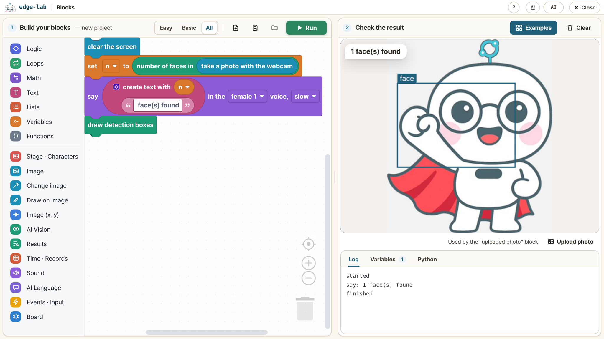

### Python — one line is enough

Call the AI through the `themaker` library. 16 examples, built-in help and autocomplete come with it.
When something goes wrong it shows **an error code · the line · what to try** instead of a Traceback (Blocks too — see the error code table in the [user guide](docs/MANUAL.md)).

```python
from themaker import *

photo = camera()                      # one shot from the webcam
print(vision("object", photo))        # what can you see
show(vision("depth", photo))          # near and far as color
speak("Hello")                        # say it out loud
```

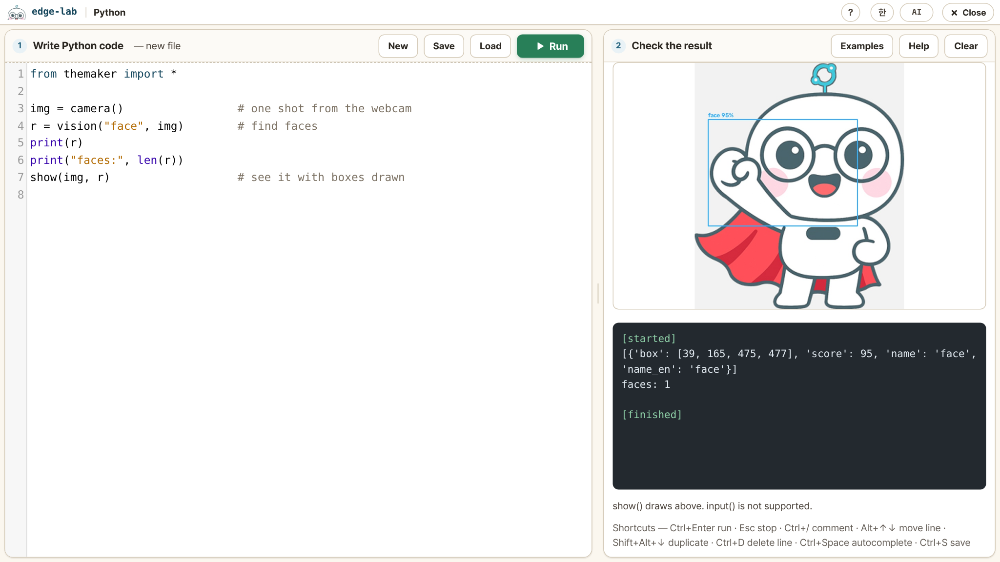

### Train — teach an AI yourself

Make the classes to tell apart (rock, paper, scissors, say), collect example photos with the webcam,
train, and test it immediately. Instead of photos it can also learn from
**hand shape · two hands · facial expression · upper body · full body**.

It shows how well it learned with accuracy and a learning curve, and shows you the ones it got wrong.
Save your AI and **use it from Try it, Blocks and Python.**
Training happens only on this computer, and your photos never leave it.

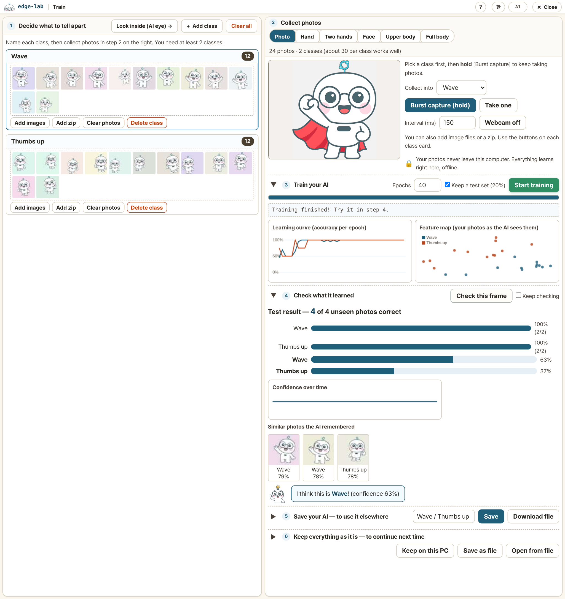

### Talk — ask by voice or text

Speak into the mic or type. Turn on **Read aloud** and it answers with a voice; pick the voice and the tone.

**Add your own notes and it answers from inside them.** Paste in class material, ask a question,
and it also shows you where the answer came from.

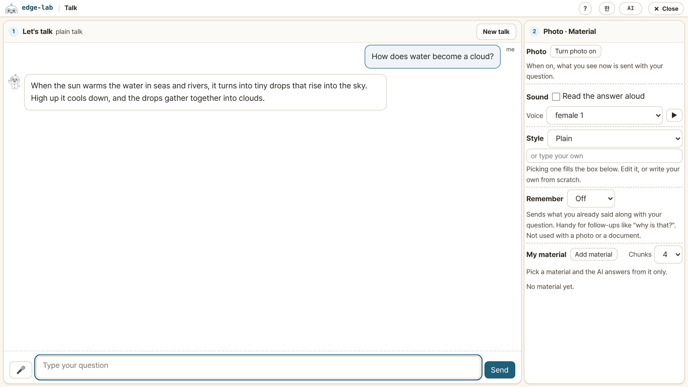

### Face AI — register faces and let the AI recognise them

Type a name and press **[Register from camera]**; from then on the name appears whenever that person is on camera.
New faces show as 'Unknown'. The info panel below shows age · gender (AI guess) · emotion · direction · distance · mask for each face.
Turn on **Speak** to have the recognised person greeted with your own sentence (`Hello, [name]!`).

- **Same model and same list file as Pibo · PiBrain.** The `facedb.json` from **[Save the list]** also opens on the robot with `Face.load_db()`, and a file the robot saved with `Face.save_db()` opens with **[Load a list]**.
- **Photos are not saved** — only numbers taken from the face (256 of them) in `face/facedb.json` on this computer; delete by name or all at once. Ask before registering someone else's face.
- Blocks (who is it · register a face) and Python (`face_register` · `face_who` · `vision("who", img)` …) use the same list.

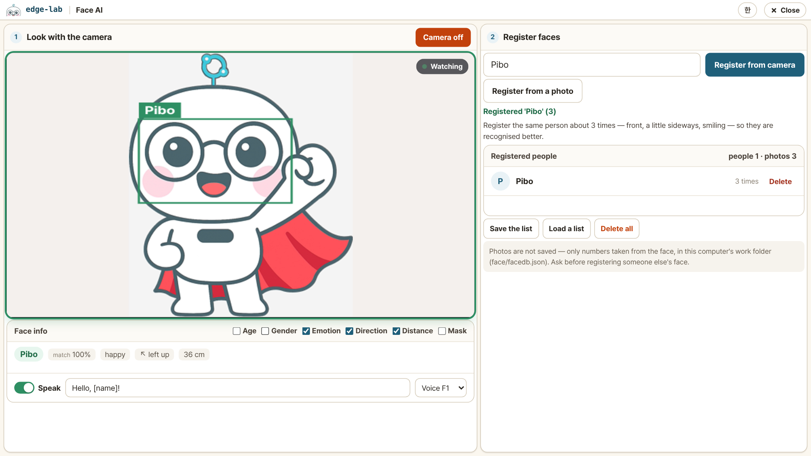

### Settings — check before class

Confirm **camera · sound · microphone** all at once. The mic test records 3 seconds and plays it straight back,
so mic and speaker are both verified together. If the screen is hard to read in a bright classroom,
turn on **Bright room**.

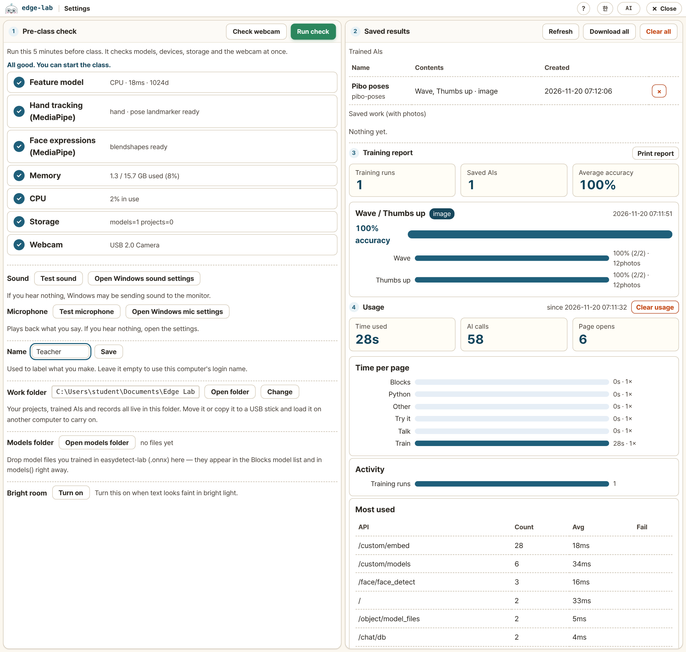

---

## The first time you open it

A progress bar runs while the AI models load into memory, and Pibo gives a short tour of what this tool does.
The first launch takes 1-2 minutes; after that it is quick.

Each screen gives a speech-bubble walkthrough the first time you open it. Press **?** at the top right to see it again.
Press **한** to switch the screen to Korean.

**You do not need a webcam.** If there is no camera, or another program is using it, the screens still work —
just upload a photo instead. The camera turns on only at the moment a photo is taken.

---

## Where your work goes

`Documents\Edge Lab` — separate from the program folder, so it survives an upgrade.

| Folder | What's in it |
|---|---|
| `user` | AI you trained |
| `project` | Work kept from Train (photos included) |
| `blocks` | Block projects |
| `pycode` | Python projects |
| `db` | Notes added in Talk |
| `stats` | Usage records · training results |
| `models` | Models brought from easydetect-lab (Settings → Models folder) |
| `notebooks` | Coding lab notebooks (lab.bat) |
| `face` | Face list registered in Face AI, `facedb.json` (numbers only, no photos) |

**[Open folder]** in Settings opens it in Explorer.

**Carry it on a USB stick** — copy the whole folder, then on another PC use **[Change]** in Settings
to point at it; your name, work and records all carry over.

---

## Install · Run

**Ready-made bundle** — get the zip from the download link in the [latest release](https://github.com/themakerrobot/edge-lab/releases/latest), unzip it and double-click `edge-lab.exe` (or `run.bat`). The coding lab is `lab.bat`, and `bundle_check.bat` checks everything. Nothing to install, and you can carry it on a USB stick to a classroom PC with no internet.

**Install from the repository** (development · class-prep PC)

What each part of every screen does is spelled out with pictures in the **[User guide](docs/MANUAL.md#edge-lab-user-guide)**.

**To install, double-click `setup.bat`** (venv, packages, models, fonts and a check). Details are in [INSTALL.md](INSTALL.md). Once installed:

```
.\run.bat
```

Double-clicking `run.bat` in Explorer works too. The browser opens by itself.

**Coding lab** — run `lab.bat` (Ubuntu: `./lab.sh`) to open JupyterLab. The 12 notebooks in `notebooks\` use
OpenVINO · numpy · OpenCV directly, no wrapper (raw object detection, face analysis, your own classifier, RAG, VLM, speech, serial board …).
Each one goes concept → practice → common errors → summary → a **mini project** (face-blur camera, people counter, business-card scanner, rock-paper-scissors, document Q&A bot, voice assistant …).
They are copied to `Documents\Edge Lab\notebooks`, so your edits survive an upgrade. **The English notebooks are in the `en\` folder there.**

Rules for changing the code are in [DEVELOP.md](DEVELOP.md).

---

## The AI running inside

| Task | Model | Runs on |
|---|---|---|
| Photo questions · chat | Gemma 3 4B INT4 | GPU |
| Objects · pose · segmentation | easydetect ed-m · pose-m · MobileSAM (.onnx) | CPU |
| Mask | MediaPipe mobilenet_v3_small embedder + classifier (one `mask.onnx`) | CPU |
| Face detection · age/gender · emotion · direction | OpenVINO pretrained | NPU |
| Face ID (Face AI · face registration) | OpenVINO face-reidentification-retail-0095 (same file as Pibo · PiBrain) | CPU |
| Face distance · hand gestures · expression training | MediaPipe | CPU |
| Depth map | Depth Anything V2 Small | GPU |
| Background removal · upscaling | U2Net · SR-1032 | GPU |
| Text recognition | easyocr (KO/EN) | CPU |
| QR recognition | OpenCV QRCodeDetector | CPU |
| Features for Train | mobilenet_v3_small 1024d (OpenVINO f32) · MediaPipe hand · face · pose — same files as the robots (`models/mediapipe/`) | CPU |
| Speech to text | SenseVoiceSmall INT8 (same files as Pibo · PiBrain) | CPU |
| Text to speech | Supertonic 3 | CPU |

---

## License

The **code of this project is Apache-2.0** (`LICENSE`, `NOTICE`).
The **models and libraries that come with it keep their own licenses** — see the table. Most are Apache-2.0 or MIT,
but **Gemma 3 (VLM) and Supertonic 3 (text to speech) have separate licenses with use restrictions**.
(Versions up to 2026-10 included YOLO (ultralytics) and were AGPL-3.0. ultralytics and its weights are no longer used.)

| Component | License |
|---|---|
| edge-lab code · notebooks | Apache-2.0 |
| easydetect (code · ed-m · pose-m weights) · MobileSAM — objects · pose · segmentation | Apache-2.0 |
| Mask classifier `mask/mask.onnx` (MediaPipe mobilenet_v3_small embedder + classifier) | Apache-2.0 |
| OpenVINO / open_model_zoo face models · upscaling (SR-1032) | Apache-2.0 |
| MediaPipe (hand · face · pose points, mobilenet_v3_small embedder, YAMNet) · U2Net · easyocr · Depth Anything V2 Small · MobileNetV2 (notebook 07 · old Train models) | Apache-2.0 |
| multilingual-e5-small (document search) · silero VAD (speech segments) | MIT |
| SenseVoiceSmall (speech-to-text weights, sherpa-onnx int8 export) | **FunASR Model License 1.1** (keep source · author attribution and the model name — full text `models/stt-sv/LICENSE-SenseVoice.txt`) |
| sherpa-onnx (speech-to-text runtime) | Apache-2.0 |
| Gemma 3 (VLM) | **Gemma Terms of Use** (with a prohibited use policy) |
| Supertonic 3 (TTS model weights) | **OpenRAIL-M** (use restrictions — below) |
| Supertonic inference procedure (speech_routes.py) · code ported from ml-lab · teach-lab | MIT |
| Blockly / TensorFlow.js / Swagger UI / CodeMirror / JSZip | Apache-2.0 / Apache-2.0 / Apache-2.0 / MIT / MIT |
| Fonts Pretendard · Gowun Dodum · Gowun Batang | SIL OFL 1.1 |

**When you pass the TTS model (OpenRAIL-M) on to someone else** — commercial use, redistribution and
hosting as a service are allowed. But you must ① include a copy of the license (`models/tts-int8/LICENSE-OpenRAIL-M.txt`),
② carry **the use restrictions in Attachment A** into your terms and make the recipient aware of them,
and ③ state that you changed the model files if you did.
Restrictions (excerpt): exploiting or harming minors, spreading disinformation, impersonating people
without consent, distributing machine-generated content without disclosing it, medical advice or
diagnosis, automated law-enforcement or immigration decisions. These restrictions apply to the
**TTS model weights only**.
