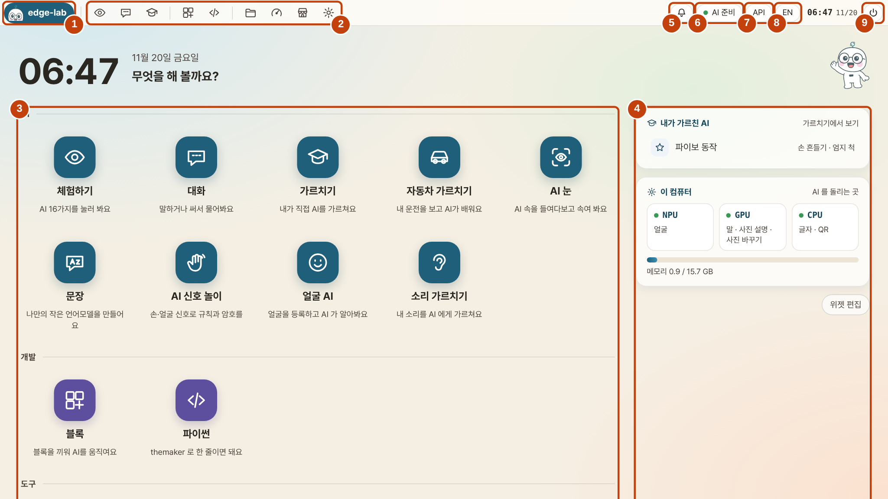
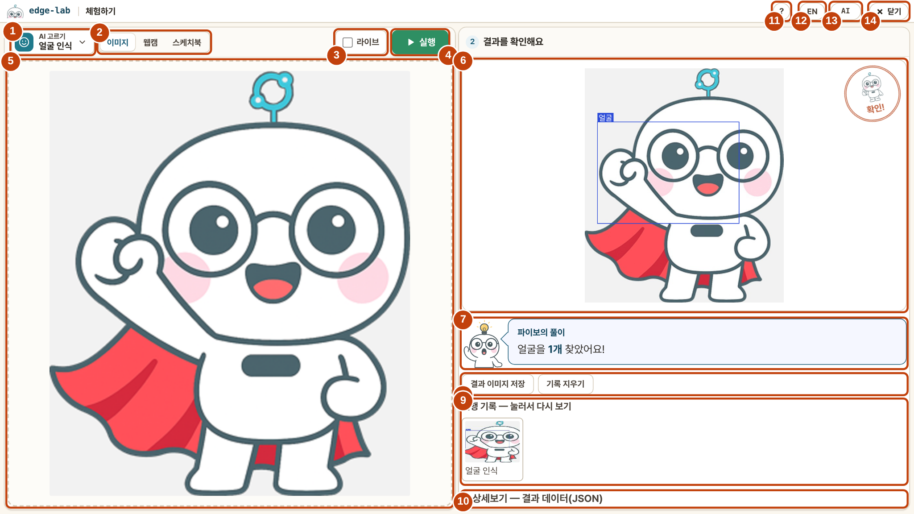
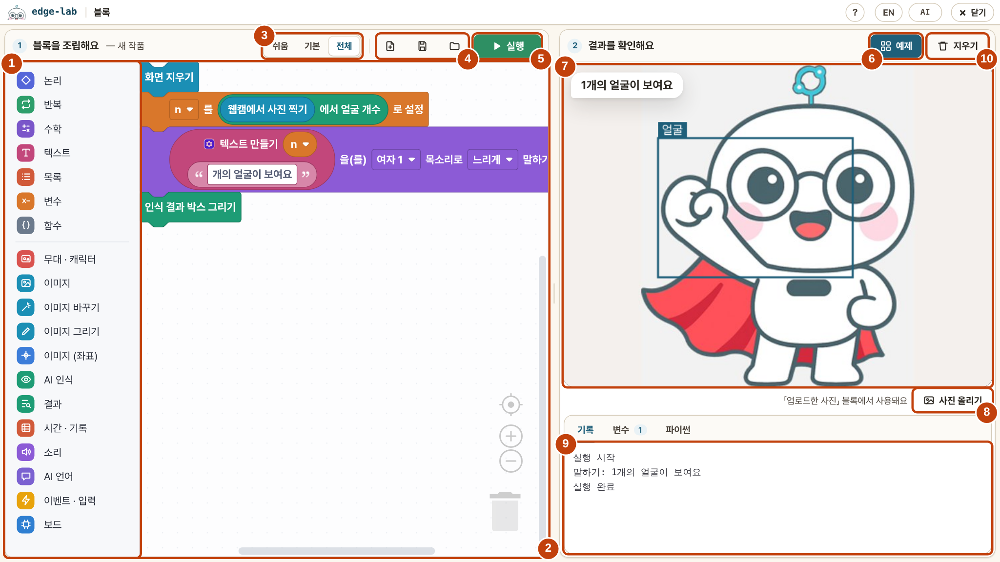
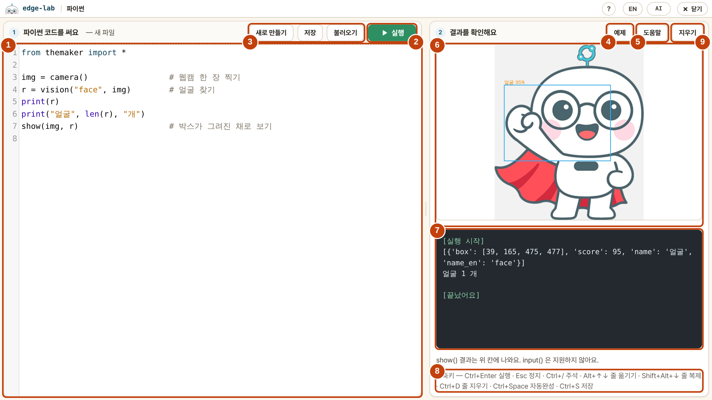
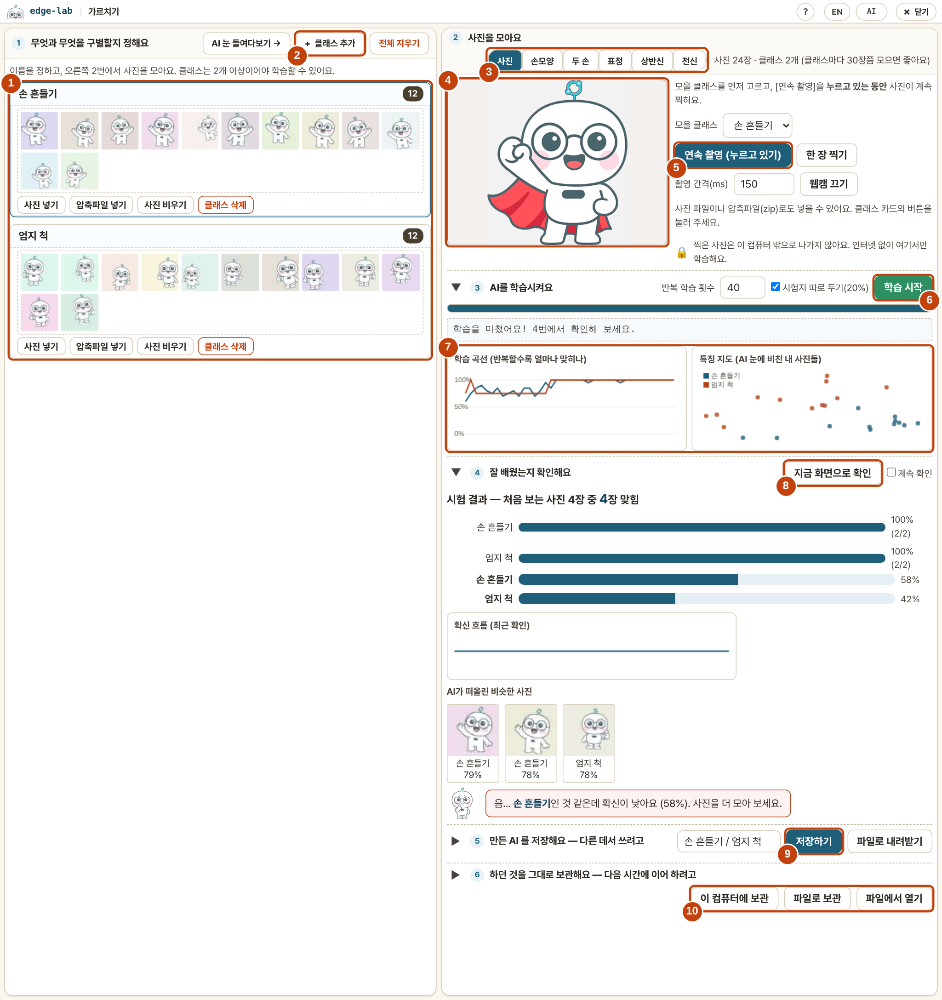
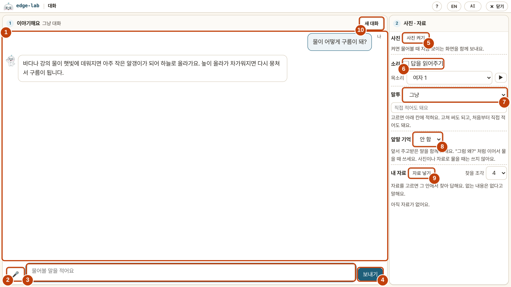
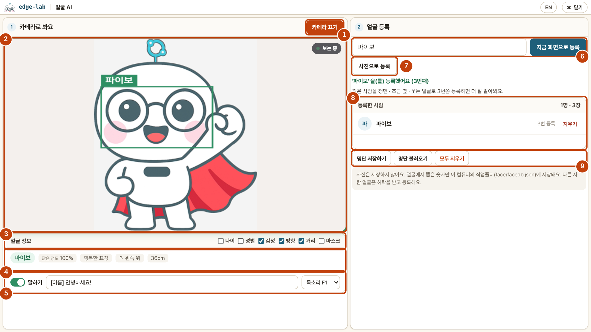
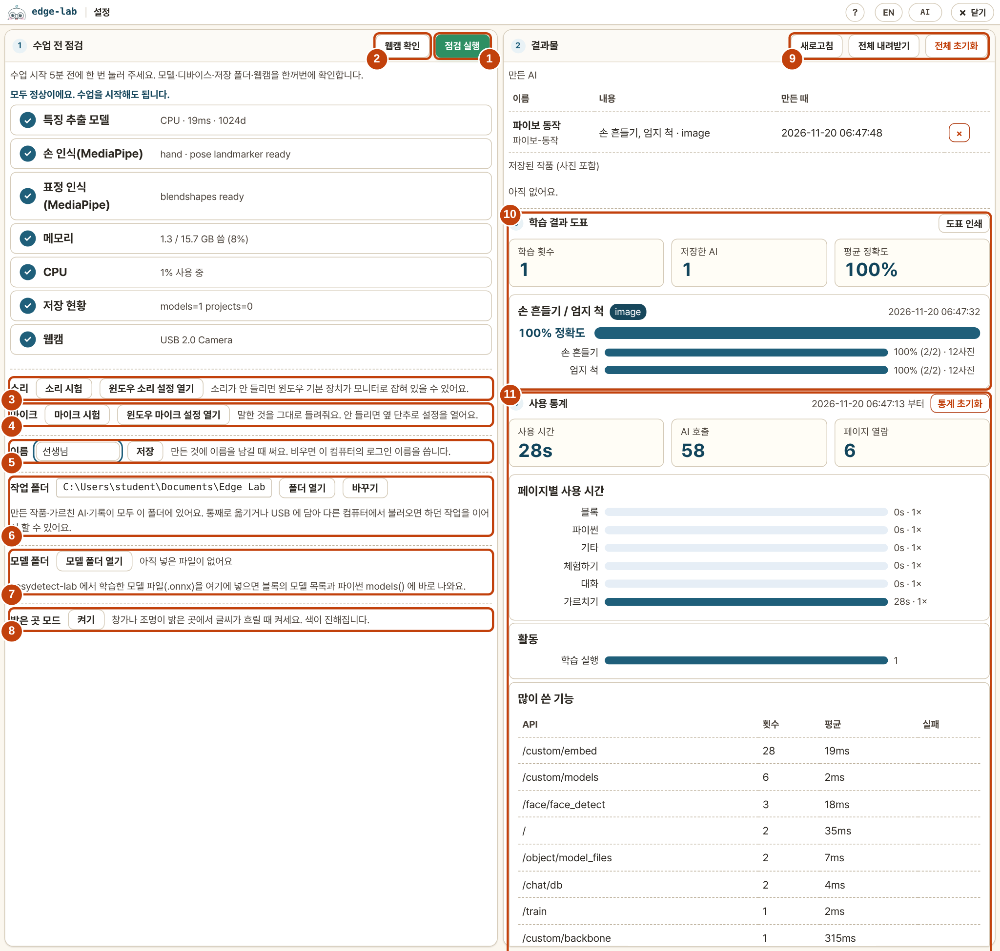

# edge-lab 사용 설명서

**한국어** · [English](#edge-lab-user-guide)

화면마다 **번호가 붙은 자리**가 무엇을 하는 곳인지만 적었습니다.

시작 — 바탕화면의 `edge-lab` 또는 `run.bat` 을 더블클릭하면 브라우저가 열립니다.
처음 켤 때는 AI를 올리느라 1~2분 걸립니다.

---

## 홈



| | |
|---|---|
| **1** | 로고 — 시작 메뉴 · 찾기 (`Ctrl+K`). 앱 · AI 기능 · 작품 · 설정을 글자로 찾아요 |
| **2** | 자주 쓰는 앱 바로 가기 |
| **3** | 앱 — AI · 개발 · 도구 묶음. 누르면 열리고, 오른쪽 위 **× 닫기**로 돌아와요 |
| **4** | 위젯 — 내가 가르친 AI · 이 컴퓨터(어느 장치가 어떤 AI 를 돌리는지 · 메모리). [위젯 편집] 으로 넣고 빼요 |
| **5** | 알림 |
| **6** | AI 준비 상태 — 처음 켤 때 AI 를 올리는 동안은 준비 중으로 나와요 |
| **7** | API 문서 (선생님용) |
| **8** | 한국어 ↔ English |
| **9** | 빠른 설정 — 이름 · 밝은 곳 모드 · 소리 · 마이크 시험 · 처음 안내 다시 보기 · 작업 폴더 · 목소리 · 바탕화면 · 선생님 모드 · 잠금 · 끄기 |

---

## 체험하기 — AI 16가지를 눌러 봐요



| | |
|---|---|
| **1** | AI 고르기 — 얼굴 · 사물 · 손 · 글자 · 사진 바꾸기 … 16가지 |
| **2** | 사진을 어디서 가져올지 — 이미지 파일 / 웹캠 / 스케치북 |
| **3** | 라이브 — 켜면 웹캠을 보며 계속 알아봐요 |
| **4** | **실행** — 스페이스바로도 돼요 |
| **5** | 사진을 넣는 칸 (끌어놓기 또는 클릭) |
| **6** | 결과 — 찾은 것에 상자와 이름이 그려져요 |
| **7** | 파이보의 풀이 — 결과를 말로 설명해 줘요 |
| **8** | 결과 이미지 저장 · 기록 지우기 |
| **9** | 실행 기록 — 눌러서 다시 보기 |
| **10** | 상세보기 — 결과 데이터(JSON). 파이썬에서 받는 값과 같아요 |
| **11** | **?** — 이 화면 안내 다시 보기 (모든 앱 공통) |
| **12** | 한국어 ↔ English |
| **13** | AI — 이 컴퓨터 상태(CPU · GPU · NPU · 메모리) |
| **14** | 닫기 — 홈으로 |

---

## 블록 — 블록을 끼워 AI를 움직여요



| | |
|---|---|
| **1** | 블록 서랍 — 논리 · 반복 · 변수 같은 기본 블록과 이미지 · AI 인식 · 소리 · AI 언어 · 이벤트 · 보드 블록 |
| **2** | 블록을 끌어다 끼우는 곳 |
| **3** | 블록 단계 — 쉬움 · 기본 · 전체 |
| **4** | 새로 만들기 · 저장 · 불러오기 — 작품은 `문서\Edge Lab\blocks` 에 |
| **5** | **실행 ▶** / 정지 |
| **6** | 예제 — 만들어진 블록을 불러와 바로 돌려 봐요 |
| **7** | 무대 — 찍은 사진 · 결과 · 캐릭터가 여기 나와요 |
| **8** | 사진 올리기 — 「업로드한 사진」 블록에서 써요 |
| **9** | 기록 · 변수 · 파이썬 — 무엇을 했는지 한 줄씩, 변수 값, 내 블록이 파이썬으로 어떻게 되는지 |
| **10** | 지우기 — 무대와 기록을 비워요 |

> 카메라는 「사진 찍기」 블록이 돌 때만 켜지고, 실행이 끝나면 꺼집니다.

---

## 파이썬 — 한 줄이면 돼요



| | |
|---|---|
| **1** | 코드를 쓰는 곳 — 자동완성은 `Ctrl+Space` |
| **2** | **실행 ▶** (`Ctrl+Enter`) — 도는 동안 정지 (`Esc`) 로 바뀌어요 |
| **3** | 새로 만들기 · 저장 · 불러오기 — `문서\Edge Lab\pycode` 에 |
| **4** | 예제 16종 |
| **5** | 도움말 — 쓸 수 있는 명령 목록 |
| **6** | `show()` 로 보낸 그림 |
| **7** | `print()` 출력 |
| **8** | 단축키 |
| **9** | 지우기 — 출력과 그림을 비워요 |

```python
from themaker import *

img = camera()                 # 웹캠 한 장 찍기
r = vision("face", img)        # 얼굴 찾기
print("얼굴", len(r), "개")
show(img, r)                   # 박스가 그려진 채로 보기
```

---

## 가르치기 — 내가 직접 AI를 가르쳐요



| | |
|---|---|
| **1** | 구별할 종류(클래스) — 이름을 정하고 사진을 모아요. 사진 넣기 · 압축파일 넣기도 돼요 |
| **2** | 클래스 추가 — 2개 이상이어야 학습할 수 있어요 |
| **3** | 무엇으로 배울지 — 사진 · 손모양 · 두 손 · 표정 · 상반신 · 전신 |
| **4** | 웹캠 화면 |
| **5** | **연속 촬영** — 누르고 있는 동안 계속 찍혀요 (클래스마다 30장쯤) |
| **6** | **학습 시작** — 반복 학습 횟수 · 시험지 따로 두기를 정할 수 있어요 |
| **7** | 학습 곡선 · 특징 지도 — 얼마나 맞히는지, AI 눈에 내 사진들이 어떻게 보이는지 |
| **8** | 확인 — 지금 화면을 보고 맞혀 봐요. 처음 보는 사진으로 본 시험 결과도 나와요 |
| **9** | 저장하기 — 체험하기 · 블록 · 파이썬에서 불러 써요 |
| **10** | 하던 것을 그대로 보관 — 사진까지 함께 두고 다음 시간에 이어서 해요 |

---

## 대화 — 말하거나 써서 물어봐요



| | |
|---|---|
| **1** | 주고받은 이야기 |
| **2** | 마이크 — 눌러서 말하기 |
| **3** | 글로 물어보기 |
| **4** | 보내기 |
| **5** | 사진 켜기 — 지금 보이는 화면을 함께 보내요 |
| **6** | 답을 읽어주기 — 목소리를 고르고 ▶ 로 미리 들어요 |
| **7** | 말투 — 고르거나 직접 적어요 |
| **8** | 앞말 기억 — "그럼 왜?" 처럼 이어서 물을 때 |
| **9** | 자료 넣기 — 넣어 둔 자료 안에서 찾아 답해요 |
| **10** | 새 대화 |

---

## 얼굴 AI — 얼굴을 등록하고 AI 가 알아봐요



| | |
|---|---|
| **1** | 카메라 켜기 · 끄기 |
| **2** | 카메라 화면 — 등록한 사람은 이름으로, 처음 보는 사람은 '모르는 사람'으로 |
| **3** | 보여 줄 정보 고르기 — 나이 · 성별(AI 짐작) · 감정 · 방향 · 거리 · 마스크 |
| **4** | 얼굴마다 나온 정보 — 누구인지 · 닮은 정도 · 고른 정보 |
| **5** | 말하기 — 알아본 사람에게 적어 둔 말을 읽어 줘요 (`[이름]` 자리에 이름이 들어가요) |
| **6** | 이름을 적고 지금 화면으로 등록 — 정면 · 조금 옆 · 웃는 얼굴로 3번쯤 하면 더 잘 알아봐요 |
| **7** | 사진 파일로 등록 |
| **8** | 등록한 사람 — 이름별로 지우기 |
| **9** | 명단 저장하기 · 불러오기(`facedb.json`, 파이보 · 파이브레인과 같은 파일) · 모두 지우기 |

사진은 저장하지 않아요. 얼굴에서 뽑은 숫자만 작업폴더의 `face/facedb.json` 에 둬요. 다른 사람 얼굴은 허락을 받고 등록해요.

---

## 설정 — 수업 전 점검



| | |
|---|---|
| **1** | 점검 실행 — 특징 모델 · 손/표정 인식 · 메모리 · CPU · 저장 · 웹캠을 한 번에 |
| **2** | 웹캠 확인 |
| **3** | 소리 시험 — 안 들리면 옆 단추로 윈도우 소리 설정을 열어요 |
| **4** | 마이크 시험 — 3초 녹음해 그대로 들려줘요 |
| **5** | 이름 — 만든 것에 함께 남아요 |
| **6** | 작업 폴더 — 작품 · 가르친 AI · 기록이 모두 여기. USB 로 옮기려면 [바꾸기] |
| **7** | 모델 폴더 — easydetect-lab 에서 학습한 `.onnx` 를 넣으면 블록 · 파이썬에 바로 나와요 |
| **8** | 밝은 곳 모드 — 밝은 교실에서 화면이 잘 안 보일 때 |
| **9** | 결과물 — 만든 AI · 저장된 작품. 새로고침 · 전체 내려받기 · 전체 초기화 |
| **10** | 학습 결과 도표 — 학습할 때마다 정확도가 남아요. 도표 인쇄 |
| **11** | 사용 통계 — 사용 시간 · AI 호출 · 화면별 사용 시간 |

---

## 만든 것은 어디에

`문서\Edge Lab` — 프로그램을 새 버전으로 덮어써도 사라지지 않습니다.

| 폴더 | 들어 있는 것 |
|---|---|
| `user` | 가르친 AI |
| `project` | 가르치기에서 보관한 작품 (사진 포함) |
| `blocks` · `pycode` | 블록 · 파이썬 작품 |
| `db` | 대화에 넣은 자료 |
| `face` | 얼굴 AI 명단 `facedb.json` (사진 없이 숫자만) |
| `models` | easydetect-lab 에서 가져온 모델 |
| `notebooks` | 코딩 실습 노트북 (lab.bat) |
| `stats` | 사용 기록 · 학습 결과 |

USB로 옮기려면 이 폴더를 통째로 복사하고, 다른 PC에서 설정의 **[바꾸기]** 로 그 폴더를 고릅니다.

---

## 잘 안 될 때

| 증상 | 해 볼 것 |
|---|---|
| 카메라가 안 켜져요 | 주소창 왼쪽 자물쇠·카메라 아이콘 → **허용**. 화상회의 앱이 쓰고 있으면 닫기 |
| 소리가 안 나요 | 설정 → **소리 시험**. 안 들리면 **윈도우 소리 설정 열기** 에서 기본 장치 확인 |
| 밝은 곳에서 글씨가 흐려요 | 설정 → **밝은 곳 모드** |
| 다시 안내를 보고 싶어요 | 오른쪽 위 **?** |

**웹캠은 없어도 됩니다** — 사진을 올려서 하면 됩니다.

---
---

<a name="edge-lab-user-guide"></a>

# edge-lab User Guide

[한국어](#edge-lab-사용-설명서) · **English**

Each screen is marked with **numbers**, and each number says what that spot does. That's all.

To start — double-click `edge-lab` on the desktop, or `run.bat`. The browser opens by itself.
The first launch takes 1-2 minutes while the AI loads.

---

## Home


| | |
|---|---|
| **1** | Logo — Start menu · search (`Ctrl+K`). Find apps, AI functions, work and settings by typing |
| **2** | Shortcuts to the apps you use most |
| **3** | Apps — grouped into AI · Develop · Tools. Press to open, **× Close** at the top right to come back |
| **4** | Widgets — AI I trained · This computer (which device runs which AI · memory). Add or remove them with [Edit widgets] |
| **5** | Notifications |
| **6** | AI status — shows loading while the AI starts up the first time |
| **7** | API docs (for teachers) |
| **8** | Korean ↔ English |
| **9** | Quick settings — name · bright room · sound · mic test · guided tour again · work folder · voice · wallpaper · teacher mode · lock · shut down |

---

## Try it — 16 kinds of AI, one press away


| | |
|---|---|
| **1** | Pick an AI — face · objects · hands · text · change the photo … 16 kinds |
| **2** | Where the photo comes from — image file / webcam / sketchpad |
| **3** | Live — keeps recognizing straight from the webcam |
| **4** | **Run** — the spacebar works too |
| **5** | Drop a photo here (drag & drop, or click) |
| **6** | Result — boxes and names are drawn on what it found |
| **7** | Pibo says — explains the result in words |
| **8** | Save result image · clear history |
| **9** | History — press one to see it again |
| **10** | Details — the result data (JSON), the same values Python gets |
| **11** | **?** — show this screen's guide again (in every app) |
| **12** | Korean ↔ English |
| **13** | AI — this computer's status (CPU · GPU · NPU · memory) |
| **14** | Close — back to Home |

---

## Blocks — snap blocks together to run the AI


| | |
|---|---|
| **1** | Block drawer — basics like logic · loops · variables, plus image · AI vision · sound · AI language · events · board blocks |
| **2** | Drag blocks here and snap them together |
| **3** | Block level — Easy · Basic · All |
| **4** | New · Save · Load — your work goes to `Documents\Edge Lab\blocks` |
| **5** | **Run ▶** / Stop |
| **6** | Examples — load a ready-made program and run it |
| **7** | Stage — the photo taken, the result and characters show here |
| **8** | Upload photo — used by the "uploaded photo" block |
| **9** | Log · Variables · Python — one line per step, variable values, what your blocks become in Python |
| **10** | Clear — empties the stage and the log |

> The camera turns on only while the "take a photo" block runs, and turns off when the run ends.

---

## Python — one line is enough


| | |
|---|---|
| **1** | Where you write code — autocomplete is `Ctrl+Space` |
| **2** | **Run ▶** (`Ctrl+Enter`) — turns into Stop (`Esc`) while it runs |
| **3** | New · Save · Load — to `Documents\Edge Lab\pycode` |
| **4** | 16 examples |
| **5** | Help — the commands you can use |
| **6** | The picture sent by `show()` |
| **7** | `print()` output |
| **8** | Shortcuts |
| **9** | Clear — empties the output and the picture |

```python
from themaker import *

img = camera()                 # one shot from the webcam
r = vision("face", img)        # find faces
print("faces:", len(r))
show(img, r)                   # see it with boxes drawn
```

---

## Train — teach an AI yourself


| | |
|---|---|
| **1** | The classes to tell apart — name them and collect photos. Add images or a zip too |
| **2** | Add a class — you need at least 2 to train |
| **3** | What it learns from — photo · hand · two hands · face · upper body · full body |
| **4** | Webcam view |
| **5** | **Burst capture** — keeps shooting while held down (about 30 per class) |
| **6** | **Start training** — set the epochs and whether to keep a test set |
| **7** | Learning curve · feature map — how often it is right, and how your photos look to the AI |
| **8** | Check — try it on what the camera sees now. The test-set result shows here too |
| **9** | Save — then use it from Try it, Blocks and Python |
| **10** | Keep everything as it is — photos included, to continue next time |

---

## Talk — ask by voice or text


| | |
|---|---|
| **1** | The conversation so far |
| **2** | Mic — press and speak |
| **3** | Type your question |
| **4** | Send |
| **5** | Turn photo on — sends what the camera sees along with your question |
| **6** | Read the answer aloud — pick a voice and preview it with ▶ |
| **7** | Style — pick one or type your own |
| **8** | Remember — for follow-ups like "why is that?" |
| **9** | Add material — it answers from inside what you added |
| **10** | New talk |

---

## Face AI — register faces and let the AI recognise them


| | |
|---|---|
| **1** | Camera on · off |
| **2** | Camera view — registered people by name, new faces as 'Unknown' |
| **3** | Pick what to show — age · gender (AI guess) · emotion · direction · distance · mask |
| **4** | Info for each face — who · how close the match is · what you picked |
| **5** | Speak — reads your sentence to the person it recognised (`[name]` becomes the name) |
| **6** | Type a name and register from the camera — about 3 times (front · a little sideways · smiling) works best |
| **7** | Register from a photo file |
| **8** | Registered people — delete by name |
| **9** | Save · load the list (`facedb.json`, the same file as Pibo · PiBrain) · delete all |

Photos are not saved — only numbers taken from the face, in `face/facedb.json` in the work folder. Ask before registering someone else's face.

---

## Settings — check before class


| | |
|---|---|
| **1** | Run check — feature model · hand/face tracking · memory · CPU · storage · webcam at once |
| **2** | Check webcam |
| **3** | Test sound — if silent, open the Windows sound settings next to it |
| **4** | Test microphone — records 3 seconds and plays it straight back |
| **5** | Name — stays with what you make |
| **6** | Work folder — projects, trained AIs and records all live here. Use [Change] to move to a USB stick |
| **7** | Models folder — drop `.onnx` files trained in easydetect-lab here and they appear in Blocks and Python |
| **8** | Bright room — when the screen is hard to read in a bright room |
| **9** | Saved results — trained AIs · saved work. Refresh · Download all · Clear all |
| **10** | Training report — accuracy is kept every time you train. Print report |
| **11** | Usage — time used · AI calls · time per page |

---

## Where your work goes

`Documents\Edge Lab` — it survives even when the program is overwritten with a new version.

| Folder | What's in it |
|---|---|
| `user` | AI you trained |
| `project` | Work kept from Train (photos included) |
| `blocks` · `pycode` | Block and Python projects |
| `db` | Notes added in Talk |
| `face` | Face AI list `facedb.json` (numbers only, no photos) |
| `models` | Models brought from easydetect-lab |
| `notebooks` | Coding lab notebooks (lab.bat) |
| `stats` | Usage records · training results |

To move it to a USB stick, copy the whole folder, then on another PC use **[Change]** in Settings to point at it.

---

## When something doesn't work

| Symptom | Try this |
|---|---|
| The camera won't turn on | Lock/camera icon left of the address bar → **Allow**. Close video-call apps that may be using it |
| No sound | Settings → **Sound test**. If still silent, **Open Windows sound settings** and check the default device |
| Text looks faint in a bright room | Settings → **Bright room** |
| I want the walkthrough again | **?** at the top right |

**You do not need a webcam** — just upload a photo instead.
